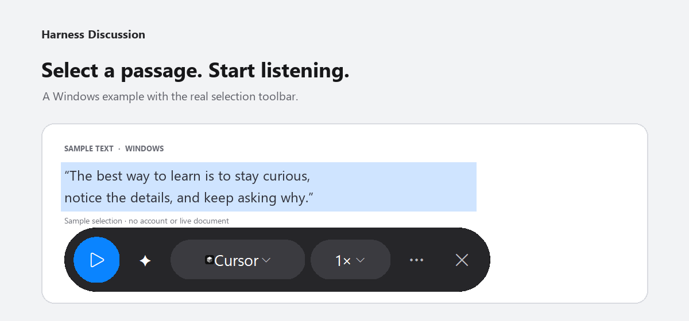
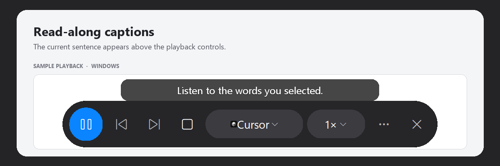
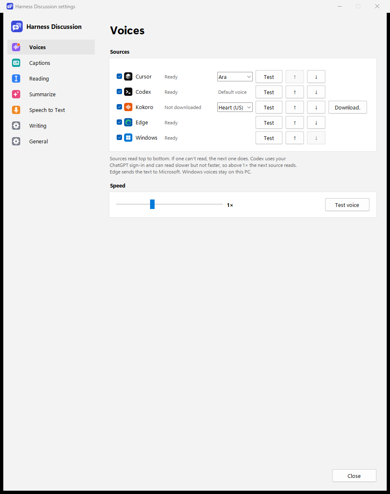

<div align="center">


# Harness Discussion

**Select text in any Windows or Mac app and hear it read aloud with the voice from your Cursor or Codex sign-in.**

Harness Discussion reads with Cursor's voices through your Cursor desktop sign-in, or with the Codex realtime voice from your ChatGPT sign-in through `codex app-server`. No API key. Local voices take over when neither can speak.

<sub>Unofficial. Not affiliated with Cursor or OpenAI.</sub>

[](https://github.com/tzachbon/harness-discussion/actions/workflows/build.yml)
[](https://github.com/tzachbon/harness-discussion/releases/latest)
[](LICENSE)


[**Download for Windows**](https://github.com/tzachbon/harness-discussion/releases/latest/download/HarnessDiscussion-Setup.exe) · [**Download for Mac**](https://github.com/tzachbon/harness-discussion/releases/latest/download/HarnessDiscussion.dmg) · [Website](https://tzachbon.github.io/harness-discussion/) · [Report a bug](https://github.com/tzachbon/harness-discussion/issues/new/choose)



</div>

## What it does

- **Works in most apps.** Drag or double-click to select text in a browser, Notepad, VS Code, or most other apps. A small **▶ Auto ⌄ 1× ⌄ Cursor ⌄** bar appears next to the selection without taking focus.
- **Reads with the sign-in you already have.** First Cursor, with any of its 28 voices, through the Cursor desktop app's sign-in. Then the Codex realtime voice through the [Codex CLI](https://github.com/openai/codex) sign-in, which uses your ChatGPT plan's Codex access and counts toward its limits.
- **Then local voices.** If neither can speak, Edge neural voices take over, then the offline Windows voices. On a Mac, the built-in macOS voice takes over.
- **You set the order.** Settings → Reading lists the sources in reading order. Turn each one on or off, move it up or down, pick its voice, and test it. The bar's source menu moves a source to the top.
- **Pause, resume, stop.** ⏸ pauses and ▶ continues from the same spot. ■ stops.
- **Speed on the bar.** 0.5× to 2×, saved and shared with Settings.
- **Read-along captions.** The current sentence appears above the bar as it plays.
- **Six languages.** Hebrew, English, Arabic, Russian, Spanish, and French.
- **Updates itself if you want.** Optional automatic updates from GitHub releases, verified by SHA-256.
- **Speech-to-text server (optional).** An OpenAI-compatible local endpoint that transcribes with the same Codex sign-in. See [STT.md](STT.md).



## Install

1. Download **[HarnessDiscussion-Setup.exe](https://github.com/tzachbon/harness-discussion/releases/latest/download/HarnessDiscussion-Setup.exe)** and run it. It installs for your user only and needs no admin rights.
2. The installer isn't code-signed, so SmartScreen may warn you. Choose *More info*, then *Run anyway*.
3. Optional: sign in to the [Cursor](https://cursor.com) desktop app, or install the [Codex CLI](https://github.com/openai/codex) (`npm i -g @openai/codex`) and sign in once with `codex login`. Without either, the app uses the Edge and Windows voices.
4. The first time it starts, the app opens Settings so you can check the voice sources.

Requirements: Windows 11, 64-bit.

## macOS

1. Download **[HarnessDiscussion.dmg](https://github.com/tzachbon/harness-discussion/releases/latest/download/HarnessDiscussion.dmg)**, open it, and drag Harness Discussion to Applications.
2. The app is ad-hoc signed, not notarized. The first time, right-click it in Applications and choose *Open*, then *Open* again. On macOS 15 and later, open *System Settings > Privacy & Security* and choose *Open Anyway*.
3. Harness Discussion lives in the menu bar. It asks for **Accessibility** access, which it needs to read the selected text. A guide window opens System Settings for you and closes once access is granted. While access is missing, the menu bar icon shows a warning.
4. Optional: sign in to Cursor, or install the Codex CLI and run `codex login`, as on Windows.

Requirements: macOS 13 or later on Apple silicon.

On a Mac, the voices are Cursor, Codex, and then the built-in macOS voice, which stays on your Mac. Edge voices and captions are Windows only for now. *Start Harness Discussion when I log in* adds a LaunchAgent. Settings are kept in `~/Library/Application Support/harness-discussion`. Updates are not installed automatically: Settings shows when a new version is out, and *Download* opens the release page.

After an update, macOS can stop trusting the app even though System Settings still lists it as allowed. Harness Discussion detects this, and the guide's *Fix permission* button clears the old entry so you can grant it again.

**Upgrading from Codex Speak or Select to TTS?** This is the same app under a new name. On Windows, the update or the new installer replaces the old app, and your settings, sign-in startup choice, and speech-to-text URL carry over. On a Mac, install the new dmg and open it once: it quits Codex Speak, moves its settings, and replaces its login item. macOS asks for Accessibility again, because the app has a new identity. You can then delete Codex Speak from Applications.

## Use

1. Select text with the mouse (drag or double-click).
2. Press ▶ on the bar. The language menu defaults to Auto.
3. Pick a speed from the bar's speed menu, and a source from its source menu.
4. ⏸ pauses and ▶ continues. ■ stops. Selecting new text while paused replaces the paused read.

Click ⚙ on the bar, the tray or menu bar icon, or start the app again from the Start menu to open **Settings**.

## Where your text goes

| Voice | Needs | Speed | Where your text goes |
| --- | --- | --- | --- |
| Cursor | Cursor desktop app, signed in | 0.5× to 2× | Cursor, through your Cursor sign-in |
| Codex realtime | Codex CLI signed in with ChatGPT | 0.5× to 1×. Above 1×, the next source reads | OpenAI, through your Codex sign-in |
| Edge neural (Windows) | Internet | 0.5× to 2× | Microsoft's Edge read-aloud service |
| Windows | Nothing, it's built in | 0.5× to 2× | Stays on your PC |
| macOS | Nothing, it's built in | 0.5× to 2× | Stays on your Mac |

- Turn off every source except Windows or macOS in Settings to keep text on your computer.
- Password fields are never read.
- The Ctrl+C fallback is skipped in terminal windows, where it would interrupt a running command.
- The log records the engine, timing, and errors, never the text itself.
- In Auto, Cursor and Codex work out the language themselves. Edge and Windows pick Hebrew, Arabic, or Russian voices from the script and use English for everything else. Choose Spanish or French from the menu for those voices.

## Settings



- **Start when I sign in to Windows**: adds or removes a Task Scheduler logon task named "Harness Discussion".
- **Check and install update / Install updates automatically**: see [Updates](#updates).
- **Speed**: 0.5× to 2×. Changes apply to the next read.
- **Sources**: under Reading, the voice sources in reading order, by default Cursor, Codex, Edge, then Windows (Cursor, Codex, then macOS on a Mac). Each row shows whether the source is ready, its voice where it has a choice, an on/off box, Test, and ↑ ↓ to change the order. If one source can't read, the next one does.
- **Captions**: font size (8 to 24 points), optional background, and background opacity. Changes apply to the visible caption right away.
- **Read apps that hide their selection**: for apps such as VS Code, the app borrows Ctrl+C and then restores every clipboard format.
- **Prepare speech as soon as I select text**: off by default. When Cursor or Edge reads first, the app requests the first sentence's audio as soon as the bar appears. This sends that sentence to Cursor or Microsoft before you press play.
- **Speech-to-text server**: see [STT.md](STT.md).

Settings are saved in `%APPDATA%\harness-discussion\settings.json`, next to a small `harness-discussion.log`.

<br clear="right">

<details>
<summary><b>Speed details</b></summary>

Cursor, Edge, Windows, and macOS voices support the full range. Codex streams speech in real time, so it can only be slowed down. Above 1×, the next source in the order reads. With only Codex turned on, it reads at its natural pace.

</details>

<details id="updates">
<summary><b>Updates</b></summary>

**Check and install update** checks the latest stable GitHub release, verifies the installer's size and SHA-256 digest, installs it into the current app folder, and relaunches. It waits for speech, including paused speech, and active transcriptions to finish.

**Install updates automatically** is off by default. When on, the app checks shortly after startup and every 24 hours, and installs when idle. Turning it off cancels a pending automatic installation. Settings and your sign-in startup choice are kept.

If a check or download fails, the app keeps running and Settings shows the error. Downloaded installers and `setup.log` are kept under `%LOCALAPPDATA%\harness-discussion\updates` for diagnosis and removed on uninstall. The digest checks that the download matches GitHub's release metadata. The installer is unsigned, so the updater trusts this repository's release account.

Update controls are disabled when running from source.

</details>

<details>
<summary><b>Uninstall</b></summary>

Use *Settings > Apps > Harness Discussion*. This removes the app, its sign-in task, and its caches in `%TEMP%`. Your settings and log in `%APPDATA%\harness-discussion` are kept.

</details>

## Known limitations

- Codex's realtime API is marked experimental. A Codex update can break it, and the next source then reads.
- Cursor speech uses the same call as the Cursor desktop app. A Cursor update can change it, and the next source then reads.
- Codex reads a whole selection in one session, in pieces of up to 480 characters, with a short pause between pieces. It reads in its own words: links become site names, file paths become file names, and commit hashes are skipped. Other voices read one sentence or paragraph at a time, so gaps can occur. Voice, language, and speed changes apply to the next complete selection.
- In testing, 5 of 16 long Codex reads had a fault: 2 lost the connection, 1 stopped early, and 2 said "Read it." aloud between pieces. Silence falls back automatically. An early stop does not.
- When Codex reads first, each popup shown pre-starts a short Codex voice session.
- Choosing a language from the menu moves keyboard focus away from the source app. The text is already captured.
- Only mouse selections trigger the bar. Keyboard selections (Shift+arrows) don't.
- Pausing the Windows voice takes effect after about a second, because SAPI keeps playing audio it has already buffered. Codex and Edge pause at once.

## Run from source

```powershell
uv sync
uv run harness-discussion     # or start .venv\Scripts\harness-discussion.exe (no console window)
uv run python -m unittest discover -s tests
```

[CONTRIBUTING.md](CONTRIBUTING.md) covers the dev setup, building the installer, releases, and a map of the code.

## Contributing

Bug reports, fixes, and new language voices are welcome. Start with [CONTRIBUTING.md](CONTRIBUTING.md). Report security issues privately as described in [SECURITY.md](SECURITY.md).

## License

[MIT](LICENSE). Not affiliated with Cursor, OpenAI, Microsoft, or Apple.
